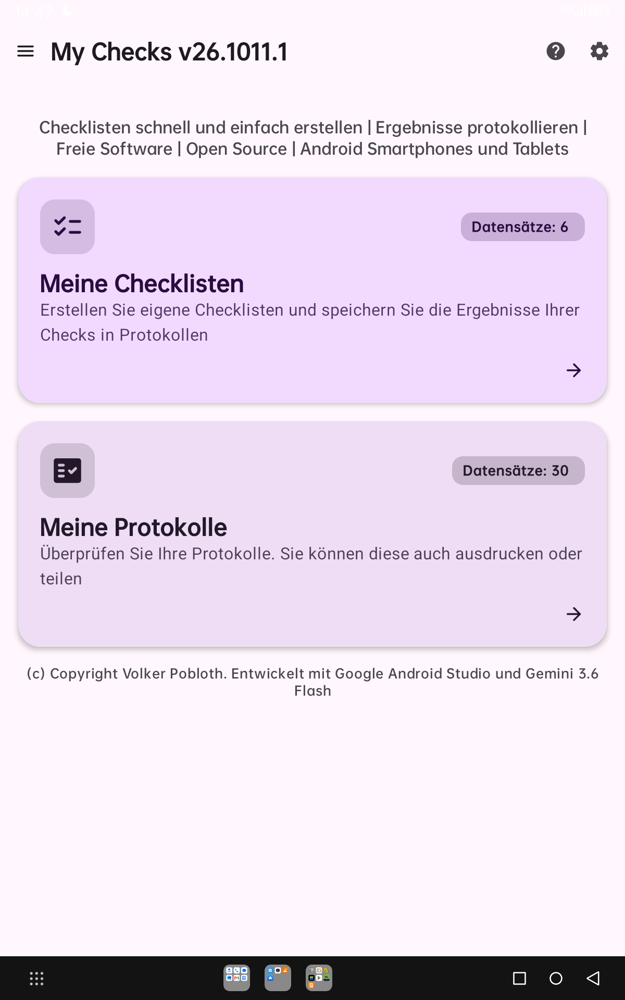
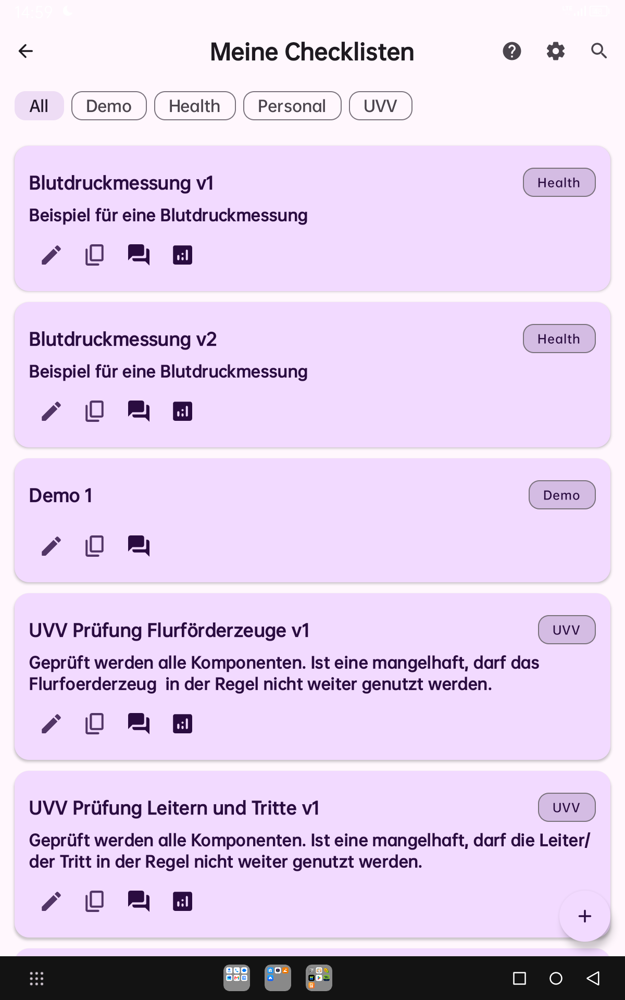
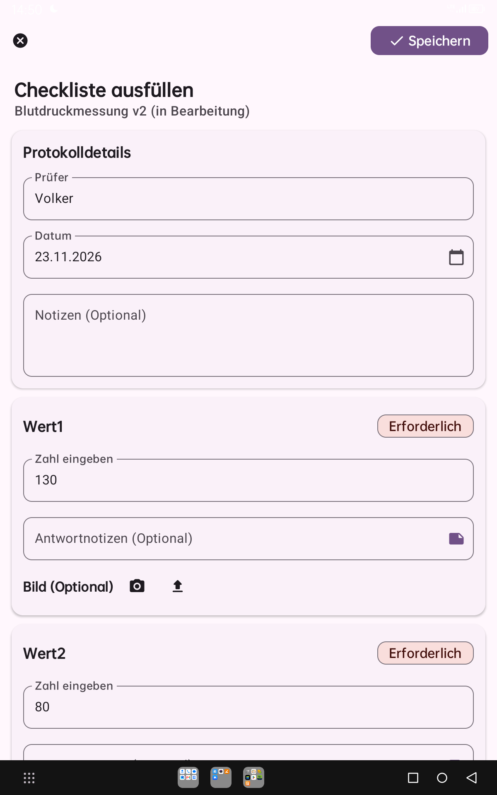
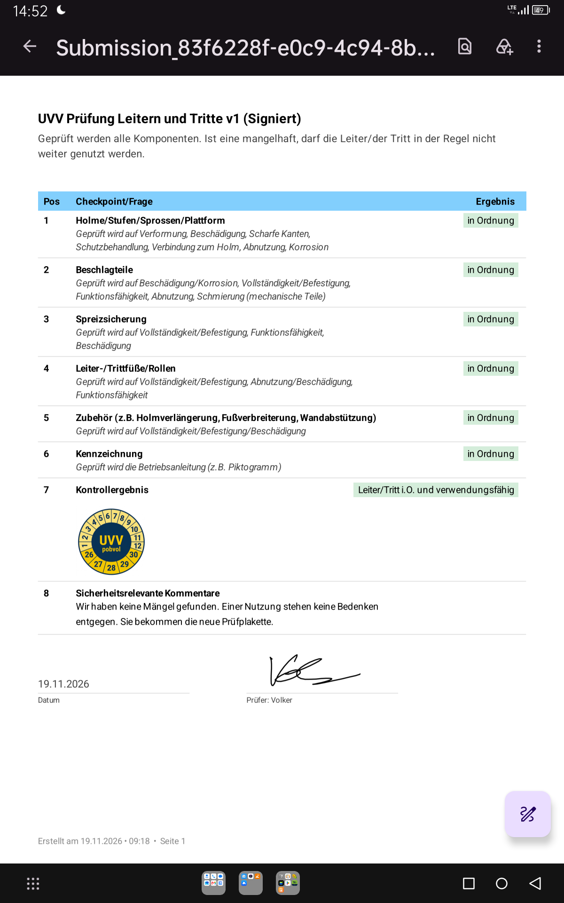

🌐 **Sprache:** [English](README.md) | [Deutsch](README.de.md) | [Español](README.es.md) | [Français](README.fr.md)

---

# ✅ pobvol My Checks

**My Checks** ist eine mobile Anwendung zum Erstellen und Verwalten digitaler Checklisten, mit denen Sie die Ergebnisse von Inspektionen und Prüfungen (wie z. B. UVV-Prüfungen, Blutdruck, etc.) erfassen und sich diese als PDF-Bericht ausgeben lassen. Die App ist Freie Software und wird als Open Source über GitHub veröffentlicht und bereitgestellt. Die App wurde mit Google Android Studio sowie Gemini 3.5 Flash Lite und Gemini 3.6 Flash entwickelt.

## 📸 Screenshots

| Dashboard | Checklisten | Erfassung | PDF |
| :---: | :---: | :---: | :---: |
|  |  |  |  |

---

## ✨ Hauptfunktionen

* 📋 **Checklisten-Verwaltung (*My Checklists*):**
  * Eigene Prüfvorlagen erstellen, duplizieren und nach Kategorien (z. B. UVV, Health, Personal) filtern.
  * Flexible Eingabetypen pro Prüfpunkt: Freitext, Zahlenwerte, Checkboxen, Auswahllisten (Combobox), Mehrfachauswahl sowie das Scannen von NFC-Tags und QR-Codes.
  * Pflicht- oder optionale Felder konfigurieren und Prüfpunkte einfach neu anordnen.
* 🔍 **Prüfungsdurchführung (*My Logs*):**
  * Prüfprotokolle nach Status (*Alle*, *Abgeschlossen*, *In Bearbeitung*), Vorlage oder Kunde filtern und durchsuchen.
  * Prüferdaten, Notizen zu Kunde und Gerät, NFC-Scans sowie Fotodokumentationen direkt vor Ort erfassen.
  * Versandfertige **PDF-Prüfberichte** inklusive Prüfergebnissen, digitalen Prüfplaketten und Unterschriften generieren.
* 📝 **Textbausteine (*Text Blocks*):**
  * Wiederverwendbare Standardtexte für wiederkehrende Mängel oder Bestätigungen mängelfreier Prüfungen erstellen, organisieren und einfügen.
* ⚙️ **Einstellungen & Lokalisierung:**
  * Mehrsprachige Benutzeroberfläche (Englisch, Deutsch, Spanisch, Französisch) und Design-Unterstützung (System, Hell, Dunkel).
  * Konfigurierbarer Standard-Prüfername, Sprachausgabe (TTS) und eigene Kategorien.
* 💾 **Datenbank & Backup:**
  * Vollständige Offline-Funktionalität mit lokalem Export/Import von Sicherungskopien, Zurücksetzen der Datenbank und integrierten Beispieldaten.

---

## 🔒 Datenschutz

* **100 % lokale Speicherung:** Alle Checklisten, Prüfprotokolle, Fotos, Textbausteine und Einstellungen werden ausschließlich lokal auf Ihrem Gerät gespeichert.

* **Keine Datenweitergabe:** Es werden keinerlei Daten an externe Server, Cloud-Dienste oder Dritte übertragen. Sie behalten jederzeit die volle Kontrolle über Ihre Prüfdaten.

* [Privacy Policy](PRIVACY_POLICY.md)

---

## ⚖️ Lizenz

Sie können die App unter den Bedingungen der GNU General Public License v3 herunterladen, installieren, betreiben, modifizieren und weiterverbreiten.  
Siehe [https://www.gnu.org/licenses/gpl-3.0](https://www.gnu.org/licenses/gpl-3.0)

---

## ⚠️ Haftungsausschluss

Die App wird in der Hoffnung bereitgestellt, dass sie nützlich sein wird, jedoch OHNE JEGLICHE GEWÄHRLEISTUNG; auch ohne die implizite Gewährleistung der MARKTGÄNGIGKEIT oder EIGNUNG FÜR EINEN BESTIMMTEN ZWECK. Der Entwickler haftet nicht für Datenverluste oder fehlerhafte Protokolle.

---

## ©️ Urheberrecht

Copyright © 2026 Volker Pobloth, pobvol Software Services
