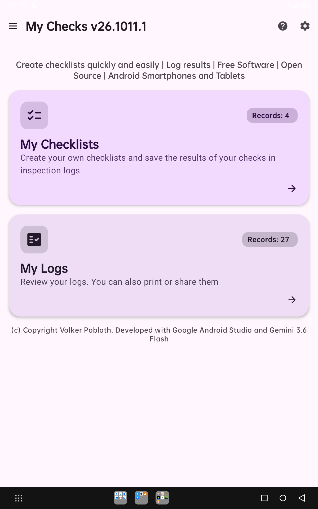
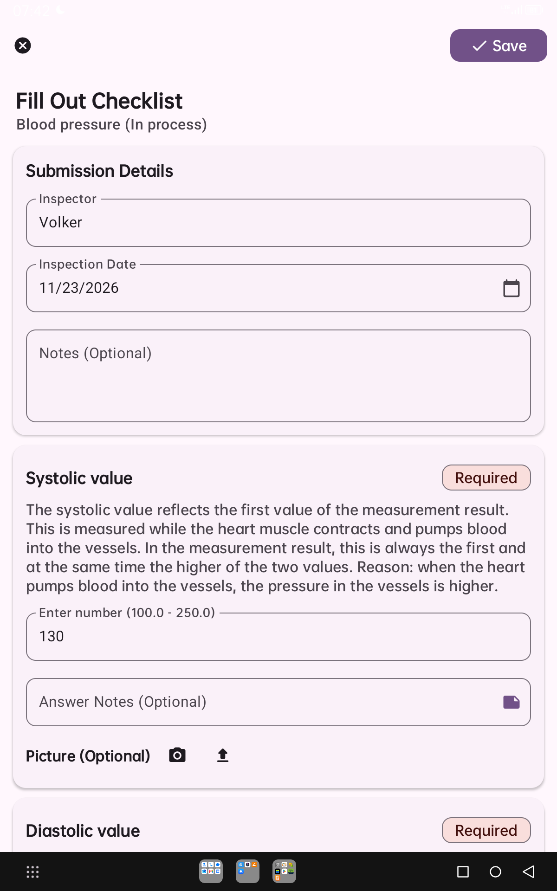

🌐 **Idioma:** [English](README.md) | [Deutsch](README.de.md) | [Español](README.es.md) | [Français](README.fr.md)

---

# ✅ pobvol My Checks

**My Checks** es una aplicación móvil para crear, gestionar y ejecutar listas de verificación digitales, inspecciones de seguridad y controles de equipos (como inspecciones UVV), con generación automática de informes en PDF. La aplicación es Software Libre, publicado y distribuido como código abierto a través de GitHub. La aplicación fue desarrollada con Google Android Studio y Gemini 3.5 Flash Lite y Gemini 3.6 Flash.

---

## 📸 Capturas de pantalla

| Panel principal | Listas de verificación | Ejecución de inspección | Informe PDF |
| :---: | :---: | :---: | :---: |
|  | <zimg src="images/en/my-checklists.png" width="200" alt="My Checklists"> |  |  |
---

## ✨ Características principales

* 📋 **Gestión de listas de verificación (*My Checklists*):**
  * Cree, duplique y filtre plantillas de inspección personalizadas por categoría (p. ej., UVV, Salud, Personal).
  * Tipos de entrada flexibles por punto de control: texto libre, valores numéricos, casillas de verificación, listas desplegables (combobox), selección múltiple, así como escaneo de etiquetas NFC y códigos QR.
  * Configure campos obligatorios u opcionales y reordene los puntos de control fácilmente.
* 🔍 **Ejecución de inspecciones (*My Logs*):**
  * Filtre y busque registros de inspección por estado (*Todos*, *Completado*, *En progreso*), plantilla o cliente.
  * Registre datos del inspector, notas del cliente/equipo, escaneos NFC y documentación fotográfica directamente en el lugar.
  * Genere **informes de inspección en PDF** listos para compartir, incluyendo resultados de pruebas, distintivos digitales de inspección y firmas.
* 📝 **Bloques de texto (*Text Blocks*):**
  * Cree, organice e inserte textos estándar reutilizables para defectos recurrentes o confirmaciones sin fallos.
* ⚙️ **Configuración y localización:**
  * Interfaz multilingüe (inglés, alemán, español, francés) y soporte de temas (Sistema, Claro, Oscuro).
  * Nombre predeterminado del inspector configurable, comentarios de voz (TTS) y categorías personalizadas.
* 💾 **Base de datos y copias de seguridad:**
  * Capacidad 100 % sin conexión con exportación/importación local de copias de seguridad, restablecimiento de base de datos y datos de demostración integrados.

---

## 🔒 Privacidad

* **Almacenamiento 100 % local:** Todas las listas de verificación, registros de inspección, fotos, bloques de texto y configuraciones se almacenan exclusivamente de forma local en su dispositivo.
* **Sin intercambio de datos:** No se transmiten datos a servidores externos, servicios en la nube ni terceros. Usted mantiene el control total sobre sus datos de inspección en todo momento.

---

## ⚖️ Licencia

Puede descargar, instalar, utilizar, modificar y redistribuir la aplicación bajo los términos de la Licencia Pública General de GNU v3 (GNU General Public License v3).  
Consulte [https://www.gnu.org/licenses/gpl-3.0](https://www.gnu.org/licenses/gpl-3.0)

---

## ⚠️ Exención de responsabilidad

La Aplicación se proporciona con la esperanza de que sea útil, pero SIN GARANTÍA DE NINGÚN TIPO; ni siquiera la garantía implícita de COMERCIABILIDAD o IDONEIDAD PARA UN PROPÓSITO PARTICULAR. El Desarrollador no se hace responsable de ninguna pérdida de datos o registros erróneos.

---

## ©️ Derechos de autor

Copyright © 2026 Volker Pobloth, pobvol Software Services
