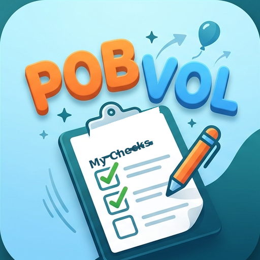
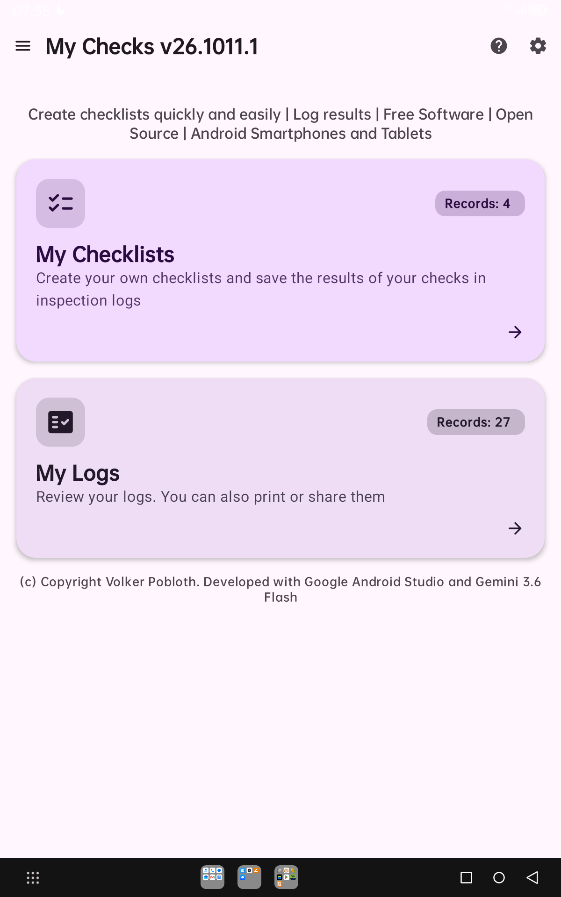
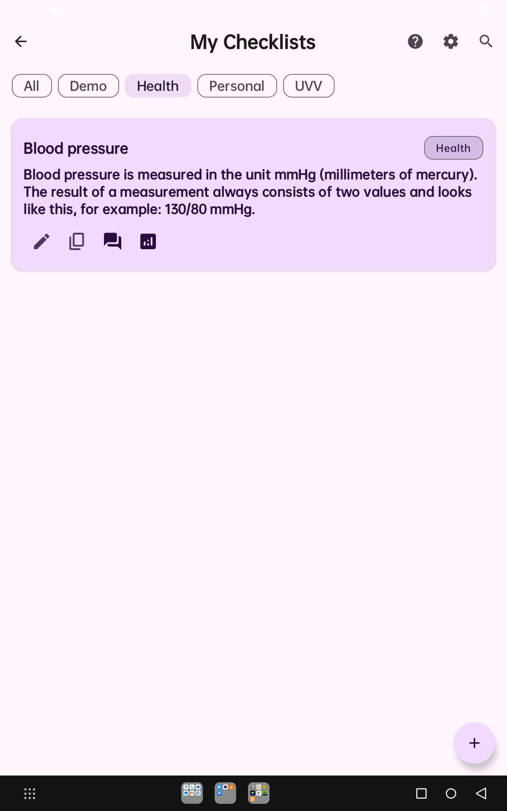
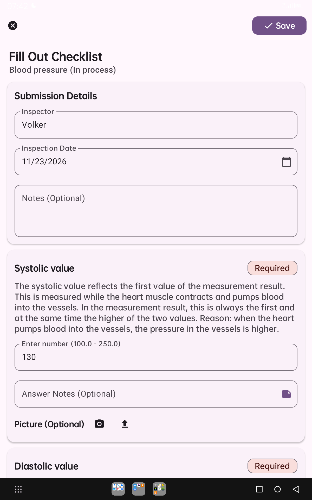
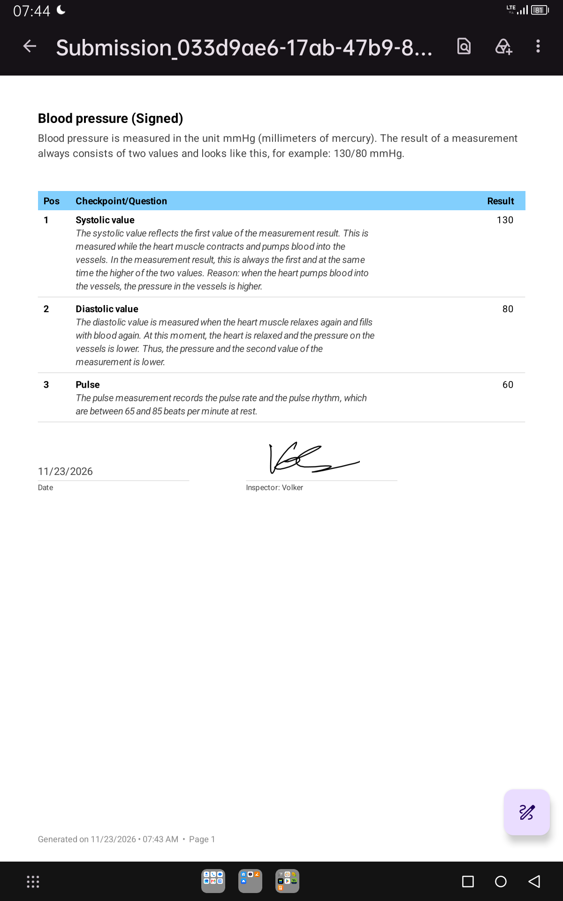
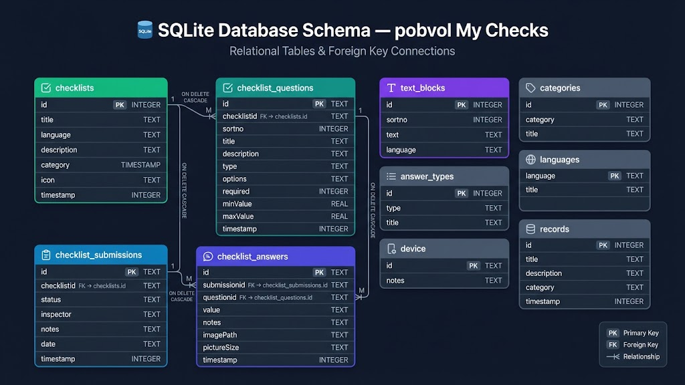

🌐 **Langue :** [English](README.md) | [Deutsch](README.de.md) | [Español](README.es.md) | [Français](README.fr.md)

---

# ✅ pobvol My Checks


 **My Checks** est une application mobile permettant de créer, gérer et exécuter des listes de contrôle numériques, des inspections de sécurité et des vérifications d'équipements (telles que les contrôles UVV), avec génération automatique de rapports PDF. L'application est un logiciel libre, publié et distribué en open source via GitHub. L'application a été développée avec Google Android Studio ainsi que Gemini 3.5 Flash Lite et Gemini 3.6 Flash.

---

## 📸 Captures d'écran

 
 

---

## ✨ Fonctionnalités principales

* 📋 **Gestion des listes de contrôle (*My Checklists*) :**
  * Créez, dupliquez et filtrez des modèles d'inspection personnalisés par catégorie (par ex. UVV, Santé, Personnel).
  * Types de saisie flexibles par point de contrôle : texte libre, valeurs numériques, cases à cocher, listes déroulantes (combobox), sélection multiple, ainsi que la lecture de tags NFC et de codes QR.
  * Configurez des champs obligatoires ou facultatifs et réorganisez facilement les points de contrôle.
* 🔍 **Exécution des inspections (*My Logs*) :**
  * Filtrez et recherchez les journaux d'inspection par statut (*Tous*, *Terminé*, *En cours*), modèle ou client.
  * Enregistrez sur place les informations de l'inspecteur, les notes relatives au client et à l'équipement, les scans NFC et les photos justificatives.
  * Générez des **rapports d'inspection PDF** prêts à être partagés, incluant les résultats des tests, les vignettes de contrôle numériques et les signatures.
* 📝 **Blocs de texte (*Text Blocks*) :**
  * Créez, organisez et insérez des textes standard réutilisables pour les défauts récurrents ou les validations sans anomalie.
* ⚙️ **Paramètres et localisation :**
  * Interface multilingue (anglais, allemand, espagnol, français) et prise en charge des thèmes (Système, Clair, Sombre).
  * Nom de l'inspecteur par défaut configurable, synthèse vocale (TTS) et catégories personnalisées.
* 💾 **Base de données et sauvegarde :**
  * Fonctionnement 100 % hors ligne avec exportation/importation locale de sauvegardes, réinitialisation de la base de données et données de démonstration intégrées.

---

## 💾 Graphique de base de données



L'image visualise précisément les relations et la structure de la base de données SQLite – des listes de contrôle aux points de contrôle/questions, en passant par les journaux, les réponses, les photos, les modules textuels et les tableaux de recherche.

---

## 🔒 Confidentialité

* **Stockage 100 % local :** Toutes les listes de contrôle, journaux d'inspection, photos, blocs de texte et paramètres sont stockés exclusivement en local sur votre appareil.

* **Aucun partage de données :** Aucune donnée n'est transmise à des serveurs externes, des services cloud ou des tiers. Vous conservez à tout moment le contrôle total de vos données d'inspection.

* [Privacy Policy](PRIVACY_POLICY.md)

---

## ⚖️ Licence

Vous pouvez télécharger, installer, utiliser, modifier et redistribuer l'application selon les termes de la licence publique générale GNU v3 (GNU General Public License v3).  
Voir [https://www.gnu.org/licenses/gpl-3.0](https://www.gnu.org/licenses/gpl-3.0)

---

## ⚠️ Clause de non-responsabilité

L'Application est fournie dans l'espoir qu'elle sera utile, mais SANS AUCUNE GARANTIE ; sans même la garantie implicite de QUALITÉ MARCHANDE ou D'ADÉQUATION À UN USAGE PARTICULIER. Le Développeur ne saurait être tenu responsable de toute perte de données ou de journaux erronés.

---

## ©️ Droits d'auteur

Copyright © 2026 Volker Pobloth, pobvol Software Services


---

## 📲 Installation (Android)

Comme **pobvol My Checks** est développé en tant que logiciel libre et open source sans dépendance à Google Play, vous pouvez installer l'application directement depuis GitHub sur votre smartphone ou tablette Android.

### Option 1 : Installation directe via APK (Rapide et simple)

1. Sur votre appareil Android, ouvrez la **[page des versions (Releases) sur GitHub](https://github.com/pobvolcom/pobvol_My_Checks_Android/releases/latest)**.
2. Faites défiler tout en bas jusqu'à la section **Assets** et appuyez sur **`app-release.apk`** pour télécharger le fichier d'installation.
3. Ouvrez le fichier téléchargé depuis le volet de notifications ou votre application **Fichiers / Téléchargements**.
4. **Autoriser l'installation (si demandé) :** Par mesure de sécurité, Android bloque par défaut les installations provenant d'autres sources que le Play Store. Appuyez sur **Paramètres** dans la fenêtre d'avertissement et activez **« Autoriser à partir de cette source »** pour votre navigateur ou gestionnaire de fichiers.
5. Appuyez ensuite sur **Installer**.

> **Remarque concernant Google Play Protect :** Si un avertissement de Play Protect s'affiche lors de l'installation (*« Application non reconnue »*), appuyez sur **Plus de détails** et sélectionnez **Installer quand même**. L'application est 100 % open source (GPL-3.0) et enregistre toutes les données exclusivement en local sur votre appareil.

---

### Option 2 : Mises à jour automatiques avec Obtainium (Recommandé)

Si vous souhaitez recevoir les futures mises à jour automatiquement directement depuis GitHub, vous pouvez utiliser l'application gratuite et open source **[Obtainium](https://github.com/ImranR98/Obtainium)** :

1. Installez **Obtainium** sur votre appareil Android.
2. Ouvrez Obtainium, appuyez sur **Ajouter une application** et collez l'URL suivante :
   ```text
   [https://github.com/pobvolcom/pobvol_My_Checks_Android](https://github.com/pobvolcom/pobvol_My_Checks_Android)
3. Appuyez sur Ajouter, puis sur Installer. Obtainium vous informera automatiquement dès qu'une nouvelle version sera publiée. 

