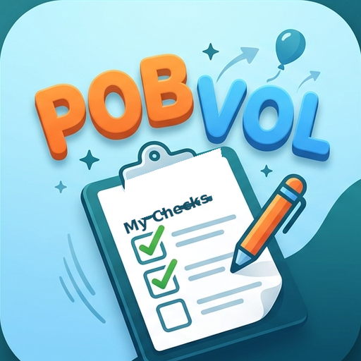
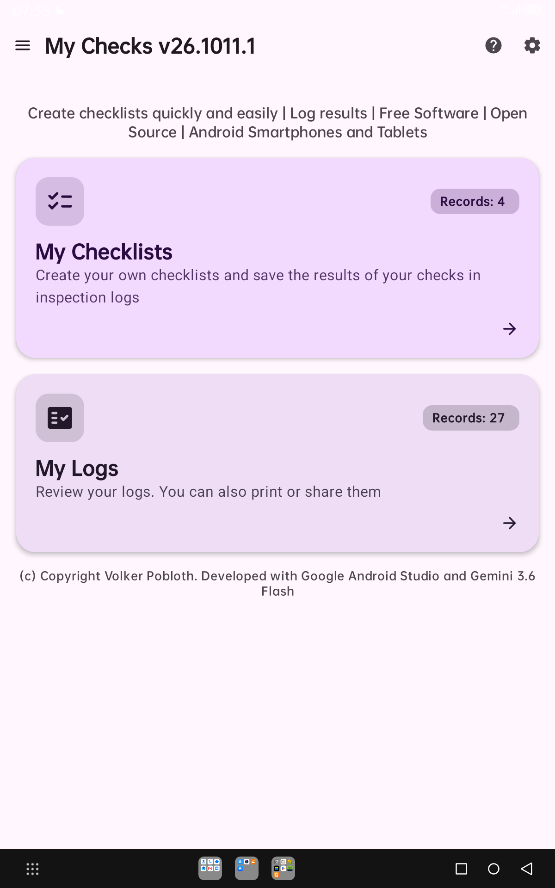
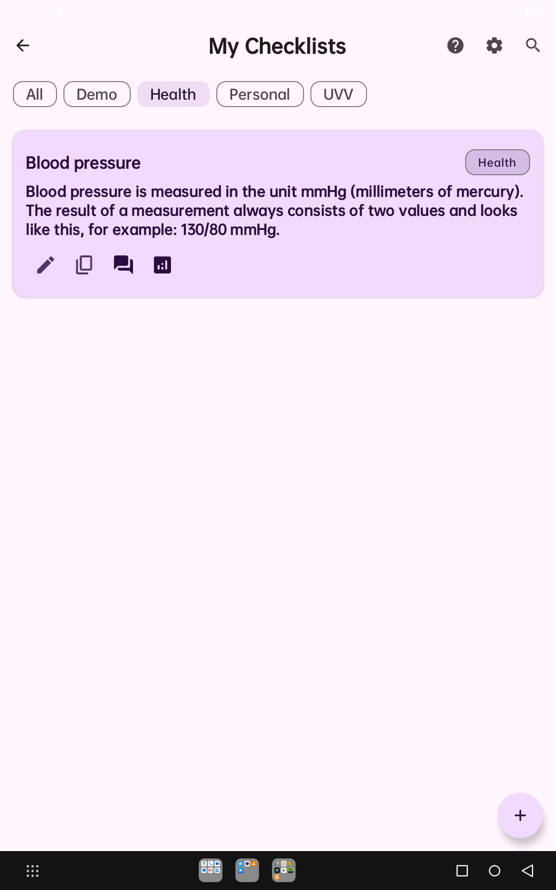
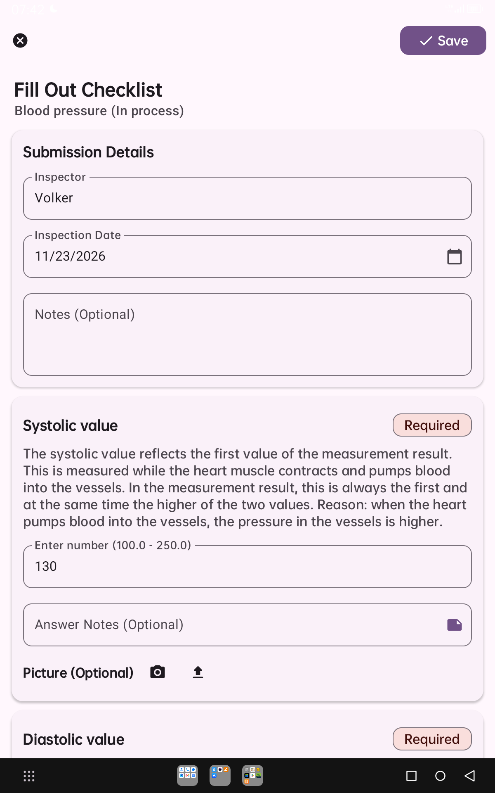
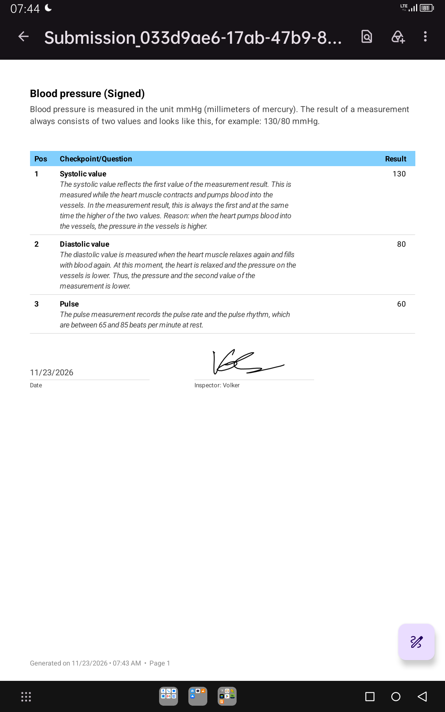
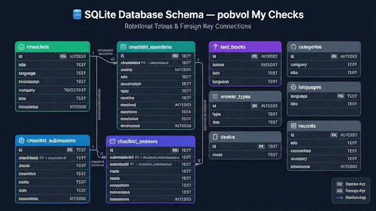

🌐 **Language:** [English](README.md) | [Deutsch](README.de.md) | [Español](README.es.md) | [Français](README.fr.md)

---

# ✅ pobvol My Checks

 **My Checks** is a mobile application for creating, managing, and executing digital checklists, safety inspections, and equipment checks (such as UVV inspections), complete with automated PDF report generation. The app is Free Software, published and delivered as open source via GitHub. The app was developed with Google Android Studio and Gemini 3.5 Flash Lite and Gemini 3.6 Flash.

---

## 📸 Screenshots

| Dashboard | Checklists | Inspection | PDF |
| :---: | :---: | :---: | :---: |
|  |  |  |  |

---

## ✨ Key Features

* 📋 **Checklist Management (*My Checklists*):**
  * Create, duplicate, and filter custom inspection templates by category (e.g., UVV, Health, Personal).
  * Flexible input types per checkpoint: free text, numeric values, checkboxes, comboboxes, multi-select, as well as NFC tag and QR code scanning.
  * Configure required or optional fields and reorder checkpoints easily.
* 🔍 **Inspection Execution (*My Logs*):**
  * Filter and search inspection logs by status (*All*, *Completed*, *In progress*), template, or customer.
  * Record inspector details, customer/device notes, NFC scans, and photo documentation on-site.
  * Generate ready-to-share **PDF inspection reports** including test results, digital inspection badges, and signatures.
* 📝 **Text Blocks (*Text Blocks*):**
  * Create, organize, and insert reusable standard texts for recurring defects or pass confirmations.
* ⚙️ **Settings & Localization:**
  * Multi-language interface (English, German, Spanish, French) and theme support (System, Light, Dark).
  * Configurable default inspector name, Text-to-Speech (TTS) voice feedback, and custom categories.
* 💾 **Database & Backup:**
  * Full offline capability with local backup export/import, database reset, and built-in demo data.

---

## 💾 Database schema

The image precisely visualizes the relationships and structure of the SQLite database from the app – from checklist templates to checkpoints, logs, photo responses, to text modules and general app settings.

---

## 🔒 Privacy

* **100% Local Storage:** All checklists, inspection logs, photos, text blocks, and settings are stored exclusively locally on your device.

* **No Data Sharing:** No data is transmitted to external servers, cloud services, or third parties. You retain full control over your inspection data at all times.

* [Privacy Policy](PRIVACY_POLICY.md)

---

## ⚖️ License

You can download, install, operate, modify, and redistribute the app under the terms of the GNU General Public License v3.  
See [https://www.gnu.org/licenses/gpl-3.0](https://www.gnu.org/licenses/gpl-3.0)

---

## ⚠️ Disclaimer

The App is provided in the hope that it will be useful, but WITHOUT WARRANTY OF ANY KIND; even without the implied warranty of MERCHANTABILITY or FITNESS FOR A PARTICULAR PURPOSE. The Developer is not liable for any loss of data or erroneous logs.

---

## ©️ Copyright

Copyright © 2026 Volker Pobloth, pobvol Software Services
